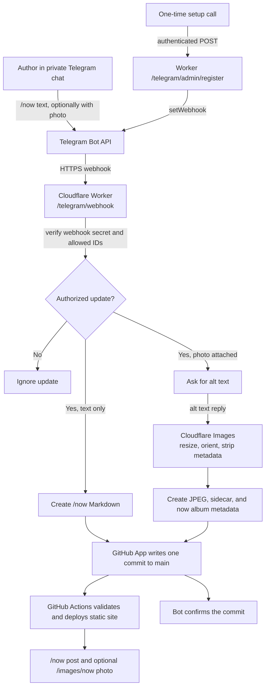

# Telegram `/now` bot

## Purpose

Use one private Telegram bot command, `/now`, to publish a short update to the
site's existing `/now` scrapbook. A post may be text only or include one photo.
When a photo is attached, the bot also adds it to a dedicated `now` album on
`/images`. The Telegram command and the website route are separate interfaces
to the same published content; there is no `/insta` command.

This is an authoring and publishing path, not a server feature for site
visitors. The static site and its GitHub Actions deployment remain unchanged.

## Proposed flow

1. Send `/now <post text>` in a private chat with the bot. A photo can be sent
   with the same command and text in its caption. Links and line breaks in the
   post text are retained as Markdown content.
2. If a photo is attached, the bot asks for image alt text before publishing.
   This keeps the gallery's accessibility requirement explicit rather than
   guessing a description from the post text.
3. The bot acknowledges the update only after it has created the Git commit.
   The existing push-to-`main` workflow validates and deploys the site.

Each successful command creates a published Markdown post in `src/blog` with
the `now` keyword and a UTC timestamp. For a photo, it also creates a
sanitized JPEG and a published image sidecar under `public/img/now`. The post
can reference that image. The `now` album is registered in
`gallery/albums.json`, categorized as `random`, and published. One commit
contains all files for an update so the gallery and post stay in sync.

Published images under `public/img` are directly reachable after deployment,
even if gallery publication is later disabled. Do not send confidential or
unsanitized images to the bot.

## Architecture

- `cloudflare/telegram-bot/src/index.js` is the Telegram Worker entry point.
  Its Wrangler config is `cloudflare/telegram-bot/wrangler.toml`.
- A Cloudflare Worker receives Telegram HTTPS webhooks on a dedicated hostname
  or path. It does not change the existing image redirect Worker or the static
  site's routes.
- The Worker checks Telegram's webhook secret header and the configured
  Telegram user and private chat IDs. It rejects group chats and all other
  senders before processing content.
- The Worker downloads the selected Telegram photo, enforces size and image
  type limits, and uses a Cloudflare Images binding to rotate, resize to at
  most 1440 pixels on the longest edge, encode JPEG at quality 95, and remove
  metadata. It must verify the transformed result against the repository's
  image metadata checks before committing it. The current Telegram Bot API
  download limit and Cloudflare Images binding input limit are both 20 MB.
- The Worker uses a narrowly scoped GitHub credential to create blobs, a tree,
  a commit, and update the `main` reference through GitHub's REST Git Database
  API. It writes only the expected `src/blog` and `public/img/now` paths. A
  branch update conflict is retried from the new `main` head so concurrent
  updates are not silently lost.
- A push to `main` invokes the existing workflow, which runs gallery
  validation and builds and deploys the static site.

The Cloudflare Images binding must be exercised with real test inputs before
launch. In particular, confirm orientation is baked into the pixels and the
result passes the same metadata checks used by the gallery. If it does not,
keep image processing in the existing Sharp-based GitHub Actions pipeline
instead of weakening the image privacy checks.

## Content and failure rules

- `/now` creates published posts, consistent with the existing local
  `/now` composer. It does not create drafts.
- A photo update is committed only after alt text is supplied and both the
  blog Markdown and image files can be written together.
- The first version accepts one still photo per update. Unsupported media,
  oversized files, missing alt text, and malformed updates get a Telegram
  explanation and do not create a commit.
- Telegram update IDs are recorded in a Cloudflare KV namespace before
  processing completes, so webhook retries do not create duplicate posts.
- Telegram bot token, webhook secret, and GitHub credential are Worker secrets;
  user/chat IDs, repository name, branch, and album path are non-secret config.
- Keep secrets out of Wrangler variables, Git, logs, and Telegram replies.

## Setup checklist

### Accounts and credentials

1. Create the bot with Telegram's `@BotFather` and save its token securely.
2. Record the numeric Telegram user ID and private chat ID allowed to publish.
3. Create a GitHub App installed only on this repository, with repository
   **Contents: Read and write** permission. Save its app ID, installation ID,
   and private key. A fine-grained token limited to this repository and
   Contents write is a simpler fallback, but an App credential is preferred.
4. Confirm the Cloudflare account has Workers and the Images binding available
   for the chosen Worker.

### Site repository

1. Create a Cloudflare KV namespace named `telegram-bot-state` and place its ID
   in the `BOT_STATE` binding in `cloudflare/telegram-bot/wrangler.toml`.
2. In Cloudflare Workers Builds, set the Worker root directory to
   `cloudflare/telegram-bot`, leave the build command empty, and use
   `npx wrangler deploy` as the deploy command. The Worker name in the
   dashboard must match `bogas04-telegram-bot` in Wrangler config.
3. Add runtime secrets in the Worker settings: `TELEGRAM_BOT_TOKEN`,
   `TELEGRAM_WEBHOOK_SECRET`, `GITHUB_APP_PRIVATE_KEY`, `TELEGRAM_USER_ID`,
   and `TELEGRAM_CHAT_ID`. The PEM value is the complete downloaded key file,
   including its begin/end lines. Store the numeric Telegram IDs as secrets as
   well, to avoid publishing this account identifier in the public repository.
4. `GITHUB_APP_ID` and `GITHUB_INSTALLATION_ID` are non-secret Worker vars in
   Wrangler config. The repository owner, name, and branch are already set
   there.
5. Keep the `IMAGES` binding enabled. The existing `bot.bogas04.fyi` custom
   domain should be attached to this Worker. The Telegram endpoint is
   `https://bot.bogas04.fyi/telegram/webhook`.
6. Register the webhook by sending an authenticated `POST` request to
   `https://bot.bogas04.fyi/telegram/admin/register`, with
   `Authorization: Bearer <TELEGRAM_WEBHOOK_SECRET>`. This endpoint can only
   register the fixed `/telegram/webhook` URL and only accepts the webhook
   secret as its credential. It calls Telegram's `setWebhook` with that same
   secret and subscribes only to message updates.

### Verification before using it for real posts

1. Run the Worker locally with synthetic webhook updates and confirm
   unauthenticated users, groups, non-`/now` messages, duplicate updates,
   unsupported files, and oversized images are rejected.
2. Test JPEG, PNG, and phone-rotated photos. Confirm the result is at most
   1440px, JPEG quality 95, correctly oriented, and free of embedded metadata.
3. Test a text-only post and a photo post against a temporary branch first.
   Run `pnpm gallery:check` and `pnpm build` on the resulting content.
4. Deploy the Worker, set the webhook, send one private test post, and verify
   the GitHub commit, GitHub Actions run, `/now` entry, `/images/now/` entry,
   and direct image URL.

## References

- [Content authoring](content-authoring.md) for blog and gallery formats,
  publication states, and the canonical image optimizer.
- [Image privacy](image-privacy.md) for rules on published image assets.
- [Build and deployment](build-and-deployment.md) for static hosting and the
  push-to-`main` deployment path.
- [Telegram Bot API](https://core.telegram.org/bots/api) for webhooks and file
  downloads.
- [Cloudflare Images binding](https://developers.cloudflare.com/images/optimization/binding/)
  for processing image bytes in a Worker.
- [GitHub REST Git Database API](https://docs.github.com/en/rest/guides/using-the-rest-api-to-interact-with-your-git-database)
  for atomically writing the post and image files in one commit.
