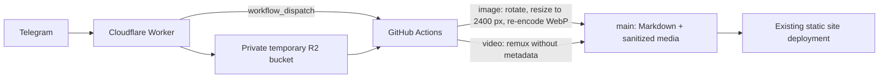

# Telegram to /now

The private Telegram bot accepts a photo or MP4 video with a caption and publishes it as a `now` scrapbook post. The flow keeps the original file private until a GitHub Actions runner processes it:



Images are orientation-corrected, resized to a maximum 2400 pixels, and re-encoded as WebP at quality 85 with Sharp. Re-encoding removes EXIF and other source metadata. MP4 videos are remuxed with metadata and chapters removed, without re-encoding the video stream. Posts are added to `src/blog` with the `now` tag; media is placed in `public/img/now` and is public after the deployment completes.

Telegram Bot API downloads are currently limited to 20 MB. The bot accepts Telegram photos, JPEG/PNG/WebP image files, and MP4 videos with a non-empty caption, only from the configured Telegram user in a private chat. Sending an image as a file avoids Telegram's photo resizing before the site's own optimization. Other formats and larger files are rejected. Video posts link to the sanitized MP4 file; image posts show the optimized image in the scrapbook.

## Free service limits

The Worker and private R2 staging bucket use Cloudflare's free allowances: Workers currently include 100,000 requests per day; R2 Standard includes 10 GB-month of storage, 1 million Class A operations, and 10 million Class B operations per month. GitHub Actions and Telegram Bot API are used for the build and bot messaging. R2 usage beyond its free allowance can be billed, so set a one-day expiration rule for the `telegram-now/` prefix as a cleanup backstop and monitor usage. The normal flow removes staged objects after each run.

## One-time setup

1. Create a Telegram bot with `@BotFather`, then send it `/start` from the account that will publish. Before enabling the webhook, call Telegram's `getUpdates` method and note the numeric `message.from.id` for your `/start` message; use that as `ALLOWED_TELEGRAM_USER_ID`.
2. Create the Cloudflare R2 bucket `bogas-now-pending-media` with public access disabled. Create an R2 API token scoped to this bucket. Configure a one-day object expiration rule for the `telegram-now/` prefix.
3. Create a GitHub fine-grained personal access token scoped to this repository with **Actions: Read and write**. The Worker uses it only to dispatch the existing build workflow.
4. Set repository variable `CLOUDFLARE_ACCOUNT_ID` and `TELEGRAM_NOW_R2_BUCKET` (use the bucket name above). Add repository secrets `TELEGRAM_NOW_R2_ACCESS_KEY_ID`, `TELEGRAM_NOW_R2_SECRET_ACCESS_KEY`, `TELEGRAM_BOT_TOKEN`, and `TELEGRAM_CHAT_ID`. The R2 credentials used by Actions should be scoped to the staging bucket.
5. From `cloudflare/telegram-now`, install or invoke Wrangler and create the bucket and Worker:

   ```sh
   npx wrangler r2 bucket create bogas-now-pending-media
   npx wrangler secret put TELEGRAM_BOT_TOKEN
   npx wrangler secret put TELEGRAM_WEBHOOK_SECRET
   npx wrangler secret put ALLOWED_TELEGRAM_USER_ID
   npx wrangler secret put GITHUB_ACTIONS_TOKEN
   npx wrangler deploy
   ```

   Enter each value when prompted. `TELEGRAM_WEBHOOK_SECRET` must be 1–256 characters using letters, digits, `_`, or `-`. The account ID, bot token, access token, and chat ID are private credentials; do not commit them.
6. Register Telegram's webhook using the deployed `workers.dev` URL, the same webhook secret, and `allowed_updates: ["message"]`. After entering the bot token, Worker URL, and webhook secret into shell variables, this command registers it without putting the token in the command text:

   ```sh
   read -rsp "Bot token: " TELEGRAM_BOT_TOKEN; echo
   read -rp "Worker URL: " TELEGRAM_WEBHOOK_URL
   read -rsp "Webhook secret: " TELEGRAM_WEBHOOK_SECRET; echo
   export TELEGRAM_BOT_TOKEN TELEGRAM_WEBHOOK_URL TELEGRAM_WEBHOOK_SECRET
   node -e 'process.stdout.write(JSON.stringify({url: process.env.TELEGRAM_WEBHOOK_URL, secret_token: process.env.TELEGRAM_WEBHOOK_SECRET, allowed_updates: ["message"]}))' \
     | curl --fail-with-body --silent --show-error "https://api.telegram.org/bot${TELEGRAM_BOT_TOKEN}/setWebhook" \
       -H "Content-Type: application/json" -d @-
   ```

   The bot can then accept photos, image files, and MP4 videos with captions.

After setup, send a photo, image file, or MP4 video with its caption to the bot. It acknowledges receipt, and GitHub Actions replies after the website deployment finishes. If a run fails, inspect the `build and deploy` workflow run in GitHub Actions. The original file remains only in the private staging bucket until the cleanup step; the R2 expiration rule removes leftovers after failures or interrupted runs.
